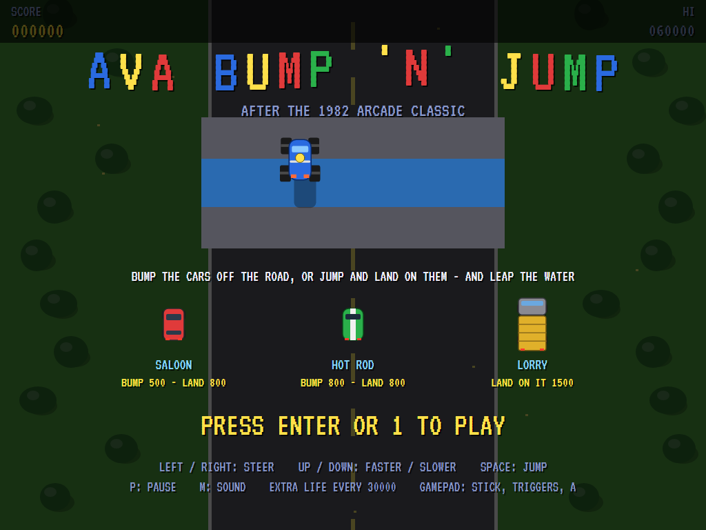
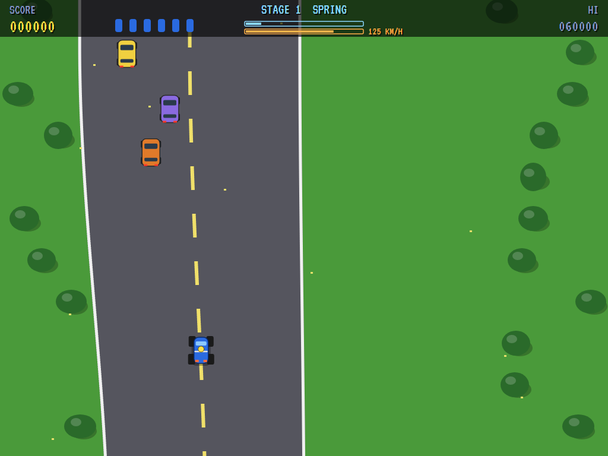
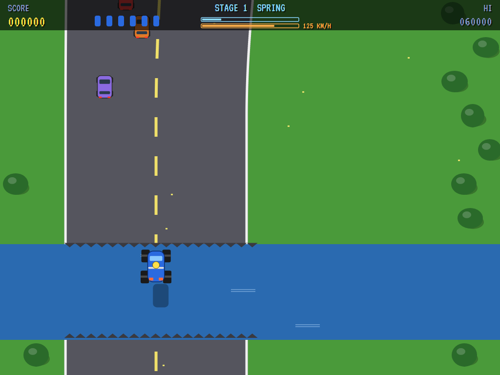
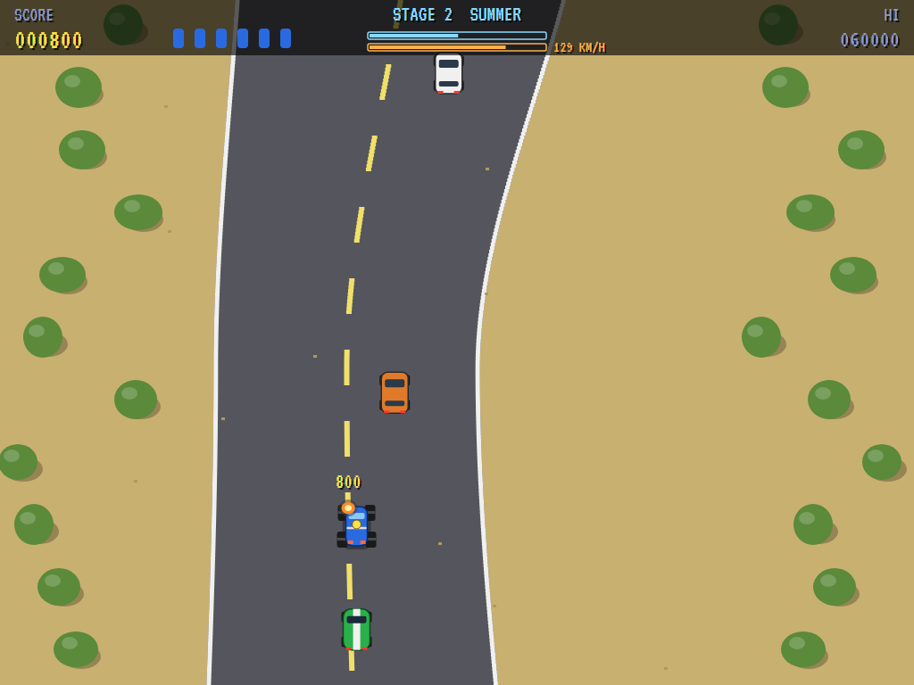
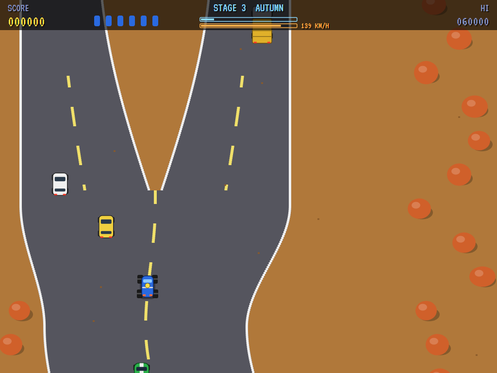
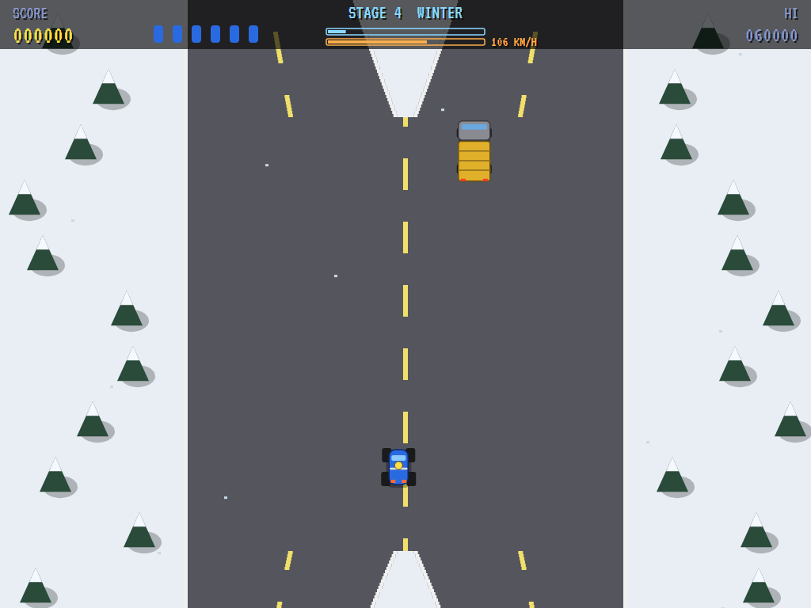
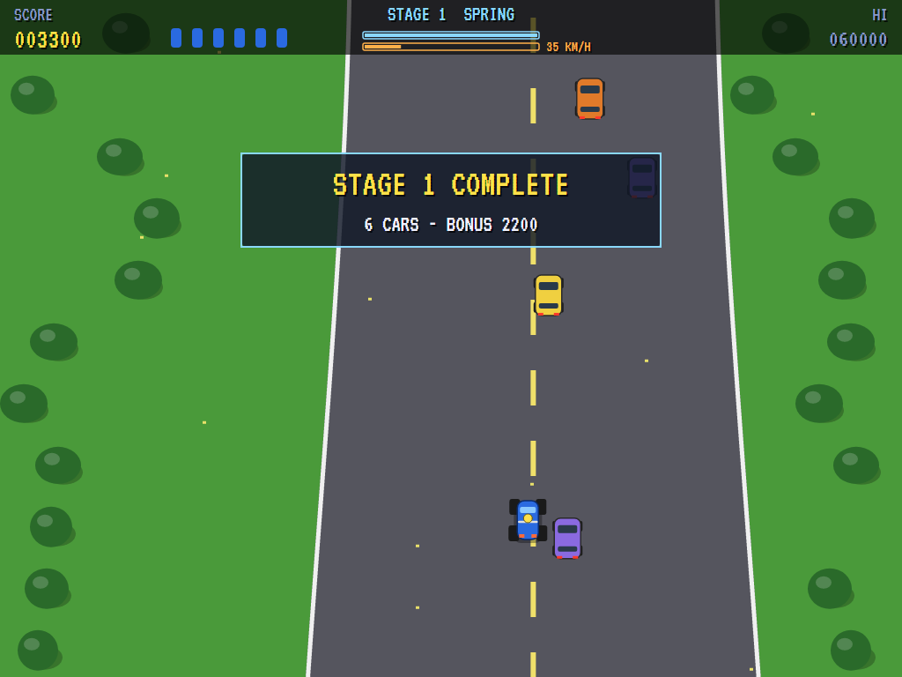
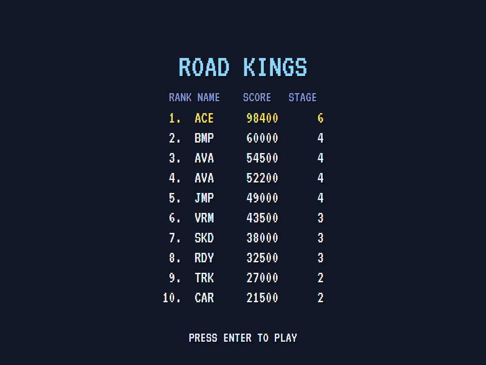

# AVA Bump 'n' Jump

[](https://github.com/Harlock123/AVABumpNJump/actions/workflows/build.yml)

A top-down driving game in the style of Data East's 1982 arcade game **Bump 'n' Jump**, built with .NET 10 and
Avalonia UI. A buggy races up a winding road through the seasons. Bump the other cars sideways off the road,
or jump and land on top of them. Leap the gaps where the road ends at the water, and go fast enough that you
clear them.

## Features

- **The buggy:**
  - **Up** speeds it up and **Down** slows it down; let go and it holds its speed.
  - **Left and Right** steer across the road.
  - **Space** jumps it into the air, as long as it's moving. The faster it's going, the further the jump
    carries.
  - Off the road, or into the back of another car, is a crash.
- **The road** winds, narrows and widens, splits round islands, and stops dead at the water. Each gap is
  narrow enough to clear at full speed, but too slow and you come down in the river.
- **The cars:**
  - **Saloons** (500 to bump off, 800 to land on).
  - **Hot rods** (800), from the second stage, come up from behind and swerve at you to bump you off.
  - **Lorries** are too heavy to bump: they shove you back instead. Land on one for 1500.
  - The cars jump the gaps too.
- **Four stages**, one for each season: **spring** green, **summer** sand, **autumn** orange, and
  **winter** snow and pines. Each is longer than the last, with more gaps and more traffic. Crossing the
  finish line pays a bonus for every car you've put off the road. There's an extra life every 30000.
- **The attract mode** drives through the seasons in turn. The computer player:
  - speeds up enough to clear each gap and jumps at the water's edge
  - keeps to its lane round the islands
  - lands on cars when a jump would come down on one
  - shoves cars alongside off the road, goes round slow ones, and gets out of the way of hot rods
- **The sounds** are all synthesised: the spring of a jump, the thump of a landing, bumps and smashes,
  splashes, and a driving tune.

## Screenshots

| The title | Spring | A leap over the water |
|:---------:|:------:|:---------------------:|
|  |  |  |
| The cars, and what they're worth. | Traffic on the road. | Clearing the river. |

| A bump | An island | Winter |
|:------:|:---------:|:------:|
|  |  |  |
| Off the road it goes. | The road splits. | A lorry ahead in the snow. |

| A stage complete | The high scores | |
|:----------------:|:---------------:|:-:|
|  |  | |
| The bonus for the cars put off the road. | The road kings. | |

The screenshots are made by the tests, which play the game in a real (headless) window; see
[Tests](#tests).

## Download and run

Ready-to-run builds for Windows, macOS and Linux, on both Intel/AMD and ARM, are on the
[Releases page](https://github.com/Harlock123/AVABumpNJump/releases/tag/latest). **Latest build** is
rebuilt on every push to `main`. Each download is one self-contained executable: no .NET install is
needed.

| Platform | Archive |
|---|---|
| Windows | `AVABumpNJump-win-x64.zip`, `AVABumpNJump-win-x86.zip`, `AVABumpNJump-win-arm64.zip` |
| macOS | `AVABumpNJump-osx-arm64.tar.gz` (Apple silicon), `AVABumpNJump-osx-x64.tar.gz` (Intel) |
| Linux | `AVABumpNJump-linux-x64.tar.gz`, `AVABumpNJump-linux-arm64.tar.gz`, `AVABumpNJump-linux-arm.tar.gz` |

```bash
tar -xzf AVABumpNJump-linux-x64.tar.gz     # or linux-arm64, linux-arm, osx-arm64, osx-x64
./AVABumpNJump
```

On Windows, unzip and run `AVABumpNJump.exe`. On macOS, if Gatekeeper refuses to open it, run
`xattr -d com.apple.quarantine AVABumpNJump` once. Run with `--no-audio` for silence.

**Sound** comes through OpenAL Soft, built in for every platform. In a virtual machine the game
detects it and uses a larger audio buffer, so the sound doesn't break up.

**Gamepads** use SDL2, which is bundled for Windows, macOS and Intel/AMD Linux. ARM Linux builds need it
installed; without it the keyboard still works:

```bash
sudo apt install libsdl2-dev            # Debian / Ubuntu / Raspberry Pi OS
sudo pacman -S --needed sdl2-compat     # Arch / Omarchy
```

## Controls

| Action | Keyboard | Gamepad |
|---|---|---|
| Start | Enter or 1 | Start |
| Steer | Left / Right (or A / D) | Left stick / D-pad |
| Faster / slower | Up / Down (or W / S) | Stick up / down, or the triggers |
| Jump | Space, Z, X or Ctrl | A or B |
| Pause | P or Esc | Start |
| Quit (while paused) | Esc | Back |
| Sound on/off | M | |
| Screenshot | Ctrl+S (to your Pictures folder) | |

On the high-score table, type your initials, or use up/down and Space, then Enter.

## Tests

```bash
dotnet test AVABumpNJump.slnx
```

The engine has no UI and runs in fixed 60 Hz steps, so it plays the same at any frame rate, and a seed
always plays the same game. The tests check:

- **The course:** every stage a road with gaps and islands, every gap clearable at full speed, the same each
  time, longer each stage, and the four seasons
- **The buggy:**
  - the pedals, holding speed, and steering
  - off the road
  - clearing the water fast enough, falling in too slow, and driving straight in
  - too slow to jump at all
- **The cars:**
  - a side bump shoving a car off for points
  - a lorry shoving back
  - running into the back of a car
  - landing on one
  - a hot rod coming at the buggy
  - traffic joining the road, and cars leaping the gaps too
- **The machine:**
  - the finish line and its bonus
  - extra lives, the last life, and initials
  - the demonstrations through the seasons, and starting a game
  - the computer player finishing the first stage
  - the same game from the same seed, and pausing

The screenshot tests draw the real screen in a headless window. To refresh the README's pictures:

```bash
BUMPNJUMP_SHOTS=$PWD/Images dotnet test tests/AVABumpNJump.Tests --filter ScreenshotTests
```

To see how the computer player gets on, stage by stage (for tuning; `1` for the pilot, `lazy` for one that
floors it, wanders, and jumps now and then):

```bash
BUMPNJUMP_PROBE=1 dotnet test tests/AVABumpNJump.Tests --filter PilotProbe --logger "console;verbosity=detailed"
```

## Building

```bash
dotnet build AVABumpNJump.slnx
dotnet run --project src/AVABumpNJump
```

Needs the .NET 10 SDK. The sounds are made by `tools/make_sounds.py` (standard-library Python):
`python3 tools/make_sounds.py` rewrites `src/AVABumpNJump/Sounds`.

## Project structure

```
AVABumpNJump/
├── AVABumpNJump.slnx
├── src/AVABumpNJump/
│   ├── Engine/
│   │   ├── GameEngine.cs        # States, the title and demo cycle, the music
│   │   ├── GameEngine.Play.cs   # The buggy and its jump; the traffic, bumps, crashes and landings;
│   │   │                        # stages and scoring
│   │   ├── DriverPilot.cs       # The computer player, for the demonstration (and the tests)
│   │   ├── Entities.cs          # The course and how it's built; the buggy and the cars
│   │   ├── HighScoreTable.cs, InitialsEntry.cs
│   │   ├── InputHandler.cs, ControllerManager.cs  # Keys and an SDL2 gamepad
│   │   └── SoundManager.cs      # Effects and the tunes through OpenAL
│   ├── Audio/                   # The OpenAL engine (from the author's AVABand)
│   ├── Views/                   # The drawing: the seasons' country, the road, the cars and the screens
│   └── Sounds/                  # The synthesised effects and tunes
├── tests/AVABumpNJump.Tests/    # Gameplay, screenshot and probe tests
├── tools/make_sounds.py
└── Images/                      # Screenshots
```

## About and licence

AVA Bump 'n' Jump © 2026 Lonnie Watson, under the [MIT License](LICENSE).

*Bump 'n' Jump* © 1982 Data East; the name belongs to its current owner. AVA Bump 'n' Jump is an independent,
unofficial game in its style. Its buggy, cars and roads, its graphics, sounds, tunes and code are its own;
nothing is taken from the arcade machine's program, graphics, sound or music. It is not affiliated with or
endorsed by any rights holder.
